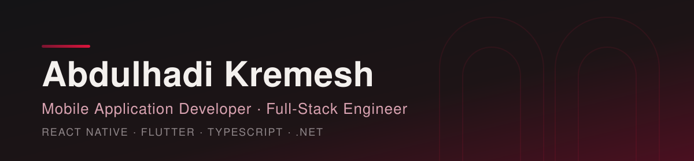

  

  
  
  

## About

I build **multilingual, production-minded mobile apps** — from the first design in Figma to the API behind the screen. My focus is clean architecture, accessible and RTL-aware interfaces, and shipping in small, tested steps.

I'm a Computer Engineering student at **Sakarya University**, working across the full stack: mobile front ends, backend services, and the data layer underneath.

## What I work with

  
  
  
  
  
  
  
  
  

| Area | Focus |
|---|---|
| **Mobile** | React Native · Expo · Flutter — reusable UI components, RTL support, typed code |
| **Backend** | FastAPI · ASP.NET Core · REST APIs · MCP integration |
| **Data** | PostgreSQL · Entity Framework Core · staged, testable migrations |
| **Design** | Figma-to-code workflows, design tokens, responsive and accessible layouts |

## Featured project

### [VET POOINT](https://github.com/EngAbdulhadi/vet-pooint)
A veterinary clinic management system: online appointment booking with conflict detection, pet and vaccination records, role-based access (admin / vet / member), a REST API, and an **MCP server** that exposes clinic tools to AI assistants. Built with ASP.NET Core MVC, PostgreSQL and a layered, reusable business core. Available in Turkish and English.

  
  
  
  

## Currently

- Building a **3D museum-style portfolio** — each project is its own exhibition room.
- Developing mobile apps with shared, design-system-driven component libraries.
- Strengthening backend foundations: scheduling, bookings and multi-role business logic.

More work will be showcased in the new portfolio soon.

## Get in touch

  

